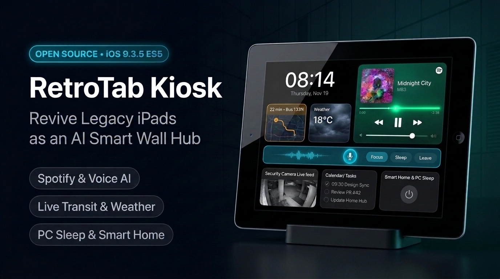
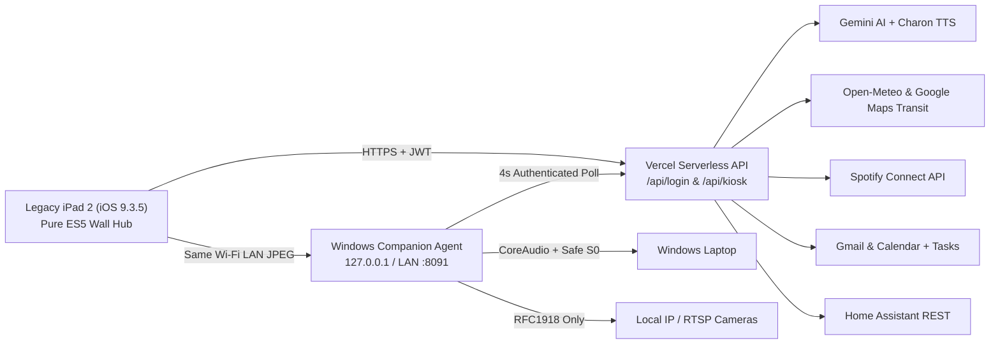

# RetroTab Kiosk

**Revive legacy iPads (iPad 2 / iOS 9.3.5) and decade-old tablets as an always-on AI Smart Wall Hub.**



[](LICENSE)
[](#why-pure-es5-for-ipad-2)
[](#why-pure-es5-for-ipad-2)
[](#quick-start-vercel)

---

## Why RetroTab Kiosk?

Millions of working **iPad 2 / iPad 3 / older Android tablets** sit in drawers because modern React, Next.js, and ES6+ apps crash or render blank white screens on WebKit 601 (iOS 9.3.5) and choke on 512 MB RAM.

**RetroTab Kiosk** turns those devices into a zero-lag, always-on smart wall hub without jailbreaking, custom firmware, or heavy bundlers:

- **100% Pure ES5 Client (`public/index.html`)** — Zero transpiler, zero `const`/`let`, zero arrow functions, zero `fetch`, zero CSS `filter: blur(...)` compositing overhead.
- **Proactive Morning Departure Assistant** — Between `07:00–09:00`, automatically announces with Gemini Charon TTS when your bus is `<= 3` stops (`<= 5` min) away — plus an umbrella reminder when rain is detected.
- **One-Tap Smart Scenes** — Trigger **Focus** (lights ON + PC volume 35% + music), **Sleep** (pause music + lights OFF + PC safe S0 standby), or **Leave Home** (lights OFF + PC sleep + spoken transit ETA) in one tap.
- **Minimal Standby Wall Clock** — Automatically dims to a pure `#000000` giant wall clock after 5 minutes of inactivity, pausing camera polling to prevent heat and burn-in.
- **Spotify Media Deck** — Track artwork, interactive scrubber seek bar, playlist picker, device switcher, and direct tablet audio preview for legacy speakers.
- **3-Tab Productivity Panel** — Switch between **Gmail Inbox**, **Google Calendar**, and **Tasks** (one-tap task completion).
- **Safe Windows Companion Agent (`agent/laptop-agent.mjs`)** — Controls Windows CoreAudio Master Volume, launches Spotify, and triggers **safe S0 Modern Standby only** (never calls `shutdown` or touches BIOS settings).
- **RFC1918 Local LAN Camera Bridge** — Streams low-latency JPEG frames from local IP/RTSP cameras directly over your home Wi-Fi with zero cloud bandwidth or serverless quota cost.

---

## System Architecture



---

## Why Pure ES5 for iPad 2?

| Bottleneck on Apple A5 / 512 MB RAM | RetroTab Kiosk Solution |
| --- | --- |
| Safari 9 throws `SyntaxError` on `const`, `let`, `=>`, template literals | **100% Pure ES5** (`var`, `function`, `XMLHttpRequest`) verified automatically in CI |
| CSS `backdrop-filter` / `filter: blur()` drops FPS to single digits | **0 ms blur cost** — crisp dark opaque cards & subtle borders |
| Constant `innerHTML` rewrites trigger full WebKit reflows | **Signature-diffed DOM updates** — skips DOM writes when payloads haven't changed |
| Web Audio / `SpeechSynthesis` double-reads or lags on iOS 9 | **Single-flight `arraybuffer` XHR -> RIFF WAV `data:` URI** unlocked by one tap |
| Continuous camera polling warms up the tablet overnight | **5-minute Minimal Standby Wall Clock** halts camera polling until tapped |

---

## Security Design

- **Zero Secrets in Source Control:** All credentials, coordinates, and personal preferences live strictly in `.env.local` / Vercel Environment Variables (see [`.env.example`](.env.example)).
- **No Fallback JWT Secret:** `api/login.js` and `api/kiosk.js` refuse to sign or verify tokens unless `JWT_SECRET` (`>= 16` chars) and `ADMIN_PASSWORD` (plaintext or `bcrypt` hash) are explicitly configured.
- **Timing-Safe Comparisons & Rate Limiting:** Constant-time credential verification plus per-IP brute-force throttling.
- **Safe PC Standby Boundary:** The local companion agent explicitly whitelists only `sleep` (S0 Display Standby), `wake`, `volume_*`, and `spotify_open` — never `shutdown`, `reboot`, or arbitrary shell execution.
- **RFC1918 Camera SSRF Guard:** The local LAN camera bridge rejects any non-private IP/host (`10.x`, `172.16-31.x`, `192.168.x`, `127.0.0.1` only), and configuration writes are locked to loopback (`127.0.0.1`).

---

## Quick Start (Vercel)

1. **Clone & Configure**
   ```bash
   git clone https://github.com/AMST0/retrotab-kiosk.git
   cd retrotab-kiosk
   cp .env.example .env.local
   ```

2. **Set Required Environment Variables** (in `.env.local` or Vercel Project Settings):

   | Variable | Required | Description |
   | --- | --- | --- |
   | `ADMIN_USERNAME` | Yes | Kiosk login username (default: `admin`) |
   | `ADMIN_PASSWORD` | Yes | Plaintext password or `bcrypt` hash (`$2b$...`) |
   | `JWT_SECRET` | Yes | Random hex string (`>= 32` chars) |
   | `KIOSK_USER_NAME` | Optional | Greeting name shown on the clock card |
   | `COMMUTE_ORIGIN_LAT` / `LON` | Optional | Home coordinates for Open-Meteo weather & transit |
   | `COMMUTE_DEST_LAT` / `LON` | Optional | Destination coordinates for transit ETA |
   | `GOOGLE_MAPS_API_KEY` | Optional | Live transit departures (falls back cleanly if unset) |
   | `GEMINI_API_KEY` | Optional | Gemini conversational AI & Charon WAV voice briefings |
   | `SPOTIFY_CLIENT_ID` / `SECRET` / `REFRESH_TOKEN` | Optional | Spotify Connect controls & playlist picker |
   | `GOOGLE_CLIENT_ID` / `SECRET` / `REFRESH_TOKEN` | Optional | Gmail inbox & Google Calendar feed |
   | `HA_URL` / `HA_TOKEN` | Optional | Home Assistant room light control |
   | `SUPABASE_URL` / `SUPABASE_SERVICE_ROLE_KEY` | Optional | Persistent `personal_tasks` sync |

3. **Deploy to Vercel**
   ```bash
   npx vercel --prod
   ```

4. **Open on your Legacy iPad 2**
   - Visit `https://your-deployment.vercel.app/` in Safari.
   - Tap **Share -> Add to Home Screen** for fullscreen borderless wall-hub mode.
   - Tap **Enable Audio** once to unlock Safari 9 inline Charon voice briefings.

---

## Optional: Windows Companion Agent & LAN Camera Bridge

To enable **Safe S0 PC Standby**, **Windows Master Volume control**, and **Zero-Cloud-Quota LAN Camera Snapshots**:

```bash
npm install
# 1. Start the companion agent
RETROTAB_CLOUD_ORIGIN=https://your-deployment.vercel.app npm run agent

# 2. Tap "Pair Code" on the Kiosk UI to get a 6-digit single-use code, then run:
node agent/laptop-agent.mjs --pair 123456 https://your-deployment.vercel.app

# 3. (Optional) Register silent auto-start on Windows logon:
npm run agent:autostart
```

To stream a local IP or RTSP camera directly to your iPad over your home Wi-Fi:
- Set `RETROTAB_CAM_MAIN_URL=http://192.168.1.50/snapshot.jpg` (or `rtsp://...` with `ffmpeg` installed) and restart the agent with `RETROTAB_AGENT_HOST=0.0.0.0`.
- On the Kiosk UI, tap **LAN** in the Camera card and enter `http://<your-laptop-lan-ip>:8091`.

---

## License

Released under the [MIT License](LICENSE). Built to keep classic hardware useful instead of ending up as e-waste.
